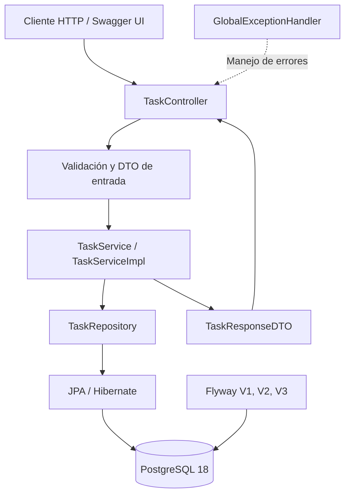
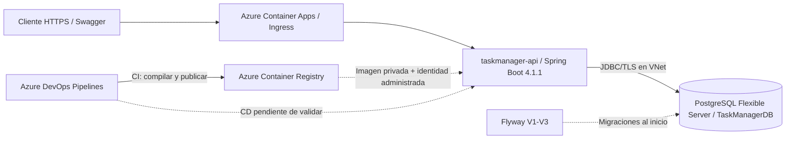

# TaskManagerAPI — Sistema de gestión de tareas


API REST desarrollada como **desafío técnico de Java Backend** para administrar tareas mediante operaciones CRUD. Incluye persistencia en PostgreSQL, migraciones de base de datos con Flyway, validación de peticiones, manejo centralizado de excepciones, documentación interactiva con Swagger/OpenAPI, pruebas automatizadas, ejecución con Docker y un pipeline de Azure DevOps.

> **Estado verificado (16 de octubre de 2026):** el servicio está desplegado en **Azure Container Apps**; la revisión `taskmanager-api--ioygsue` se reportó **Healthy** con una réplica activa y el 100 % del tráfico. Los logs confirman el arranque de Java 21/Spring Boot 4.1.1, la conexión a PostgreSQL en Azure y las **tres migraciones Flyway** aplicadas. **Swagger UI público ya fue abierto y comprobado.** El CI (20 pruebas y publicación de imagen en ACR) está validado; **falta confirmar mediante una ejecución exitosa la etapa de despliegue automático (CD)**. La accesibilidad y los estados de Azure pueden cambiar con el tiempo.

### Demostración en Azure

- **Swagger UI:** https://taskmanager-api.wittysea-ba809eb0.mexicocentral.azurecontainerapps.io/swagger-ui/index.html
- **Documento OpenAPI (JSON):** https://taskmanager-api.wittysea-ba809eb0.mexicocentral.azurecontainerapps.io/v3/api-docs
- **URL base HTTPS:** `https://taskmanager-api.wittysea-ba809eb0.mexicocentral.azurecontainerapps.io`

> **Aviso de seguridad:** la API está expuesta a Internet y no se ha verificado autenticación/autorización en sus operaciones de escritura. El enlace se ofrece como demostración técnica; no debe tratarse como una API de producción protegida. Las credenciales deben almacenarse como secretos en Container Apps y rotarse de inmediato si se han divulgado.

## Contenido

1. [Características](#características)
2. [Tecnologías](#tecnologías)
3. [Arquitectura y decisiones de diseño](#arquitectura-y-decisiones-de-diseño)
4. [Modelo de datos y reglas de negocio](#modelo-de-datos-y-reglas-de-negocio)
5. [Endpoints REST](#endpoints-rest)
6. [Ejemplos de uso](#ejemplos-de-uso)
7. [Requisitos previos](#requisitos-previos)
8. [Ejecución con Docker Compose](#ejecución-con-docker-compose)
9. [Ejecución local sin Docker para la API](#ejecución-local-sin-docker-para-la-api)
10. [Migraciones Flyway](#migraciones-flyway)
11. [Pruebas automatizadas](#pruebas-automatizadas)
12. [CI/CD con Azure DevOps](#cicd-con-azure-devops)
13. [Infraestructura en Microsoft Azure](#infraestructura-en-microsoft-azure)
14. [Seguridad y configuración](#seguridad-y-configuración)
15. [Estructura del proyecto](#estructura-del-proyecto)
16. [Control de versiones](#control-de-versiones)
17. [Consideraciones y pendientes](#consideraciones-y-pendientes)

## Características

- Crear tareas con título obligatorio y descripción opcional.
- Consultar una tarea por ID y listar las tareas existentes.
- Modificar la descripción y el estado de tareas no completadas.
- Eliminar tareas que no estén marcadas como `Completed`.
- Asignación automática del identificador, estado inicial `Pending` y fecha de creación en UTC.
- Respuestas mediante DTO para separar el contrato HTTP del modelo de persistencia.
- Manejo uniforme de errores de validación, JSON inválido, recursos inexistentes y conflictos de negocio.
- Persistencia mediante Spring Data JPA y migraciones versionadas mediante Flyway.
- Documentación Swagger UI y OpenAPI.
- Pruebas unitarias, pruebas de controlador y prueba de arranque de Spring.
- Contenedores para API y PostgreSQL, con volumen persistente para la base de datos.
- Pipeline de Azure DevOps para compilar, probar y publicar imágenes en Azure Container Registry.
- API ejecutándose en Azure Container Apps (Consumption) con acceso HTTPS público y PostgreSQL Flexible Server mediante red privada.

## Tecnologías

| Componente | Tecnología |
|---|---|
| Lenguaje | Java 21 |
| Framework | Spring Boot 4.1.1 |
| API HTTP | Spring Web MVC / REST |
| Persistencia | Spring Data JPA, Hibernate |
| Base de datos | PostgreSQL 18 |
| Migraciones | Flyway |
| Validación | Jakarta Bean Validation |
| Documentación | springdoc-openapi / Swagger UI |
| Compilación | Gradle (Wrapper; 9.8.1 en CI) |
| Pruebas | JUnit Jupiter, Mockito, MockMvc, Spring Boot Test |
| Contenedores | Docker y Docker Compose |
| Control de versiones | Git / GitHub / Azure Repos |
| Automatización | Azure Pipelines |
| Servicios en Azure | Azure Container Registry, PostgreSQL Flexible Server, Azure Container Apps (despliegue verificado) |

## Arquitectura y decisiones de diseño

El proyecto sigue una **arquitectura en capas**, separando las responsabilidades HTTP, las reglas de negocio y la persistencia:



**Decisiones de diseño:**

- **Controller–Service–Repository:** el Controller recibe peticiones y devuelve respuestas HTTP; el Service implementa reglas de negocio; el Repository encapsula el acceso a datos.
- **Repository:** `TaskRepository` extiende `JpaRepository<Tasks, Integer>`, aprovechando operaciones CRUD provistas por Spring Data JPA.
- **Dependency Injection:** Spring administra las dependencias entre Controller, Service y Repository.
- **DTO:** `TaskCreateDTO`, `TaskUpdateDTO` y `TaskResponseDTO` limitan qué información entra y sale de la API, sin exponer directamente la entidad JPA.
- **Unit of Work / transacciones:** no existe una clase propia llamada `UnitOfWork`. El comportamiento transaccional se implementa mediante `@Transactional` y el contexto de persistencia de JPA/Hibernate, que coordina las operaciones de cada transacción.
- **Migraciones explícitas:** Flyway administra los cambios de esquema; Hibernate está configurado con `ddl-auto=validate` para validar la estructura en lugar de generarla automáticamente.
- **Manejo centralizado de excepciones:** `GlobalExceptionHandler` convierte errores de aplicación en respuestas HTTP coherentes.
- **Despliegue reproducible:** Docker Compose levanta una API y una base PostgreSQL independientes del PostgreSQL instalado en el equipo anfitrión.

## Modelo de datos y reglas de negocio

### Entidad `Tasks`

Tabla: **`management.tasks`**.

| Campo | Tipo conceptual | Restricciones |
|---|---|---|
| `id` | Entero | Clave primaria, generado automáticamente |
| `title` | VARCHAR(250) | Obligatorio, no vacío en la validación del POST |
| `description` | TEXT | Opcional |
| `status` | VARCHAR(20) | `Pending`, `InProgress`, `Completed` |
| `creation_date` | TIMESTAMPTZ | Obligatorio; el Service asigna la fecha en UTC |

### Reglas implementadas

1. Una tarea nueva siempre se crea con estado `Pending`.
2. El título es obligatorio (no puede ser vacío ni contener solo espacios) y tiene un máximo de 250 caracteres.
3. El ID y la fecha de creación los asigna el sistema.
4. El título no se modifica mediante PUT; el DTO de actualización solo contiene `description` y `status`.
5. Una tarea en estado `Completed` no puede modificarse ni eliminarse: el Service devuelve un conflicto de negocio.
6. Mientras no esté completada, la tarea puede recibir cualquiera de los estados válidos del enum, incluidos `Pending`, `InProgress` y `Completed`.
7. En PUT, los campos omitidos o recibidos como `null` no se actualizan. Por ello, enviar `description: null` **no borra** una descripción existente.
8. Los identificadores nulos o menores que 1 no son válidos; un ID positivo sin registro produce una excepción de recurso inexistente.
9. **Comportamiento actual especial:** si `GET` del listado encuentra cero tareas, el Service produce `404 Not Found` en lugar del habitual `200 OK` con `[]`.

## Endpoints REST

**URL base real del Controller en la rama `master`:** `/taskmanagement`.

| Método | Ruta implementada | Descripción | Éxito |
|---|---|---|---|
| `POST` | `/taskmanagement/task` | Crear tarea | `201 Created` |
| `GET` | `/taskmanagement/allTasks` | Obtener tareas | `200 OK` (si existen) |
| `GET` | `/taskmanagement/task/{id}` | Obtener tarea por ID | `200 OK` |
| `PUT` | `/taskmanagement/modifyTask/{id}` | Actualizar descripción y/o estado | `200 OK` |
| `DELETE` | `/taskmanagement/deleteTask/{id}` | Eliminar tarea | `200 OK` |

> **Diferencia pendiente respecto del enunciado:** el desafío solicita `POST /api/tasks`, `GET /api/tasks`, `GET /api/tasks/{id}`, `PUT /api/tasks/{id}` y `DELETE /api/tasks/{id}`. Las rutas de la tabla reflejan **el código publicado actualmente**. Deben homologarse con el contrato solicitado antes de cerrar la entrega si el evaluador exige coincidencia exacta.

### Códigos de error

| HTTP | Situación |
|---|---|
| `400 Bad Request` | ID inválido, título inválido, JSON mal formado o valor de `status` no reconocido |
| `404 Not Found` | ID inexistente; también listado vacío en la implementación actual |
| `409 Conflict` | Intento de modificar o eliminar una tarea `Completed` |

Formato de error esperado de `ErrorResponseDTO`:

```json
{
  "message": "La tarea con ID 999 no fue encontrada.",
  "status": 404,
  "timestamp": "2026-10-16T12:00:00Z"
}
```

La fecha del ejemplo es ilustrativa. El mensaje de estado inválido indica los valores permitidos: `Pending`, `InProgress` y `Completed`.

## Ejemplos de uso

Los siguientes ejemplos utilizan la API dentro de **Docker Compose** en `http://localhost:8081`.

### Crear una tarea

**POST** `http://localhost:8081/taskmanagement/task`

```json
{
  "title": "Preparar prueba técnica",
  "description": "Terminar documentación y pipeline"
}
```

Respuesta de ejemplo, `201 Created`:

```json
{
  "id": 1,
  "title": "Preparar prueba técnica",
  "description": "Terminar documentación y pipeline",
  "status": "Pending",
  "creationDate": "2026-10-16T12:00:00Z"
}
```

### Consultar todas las tareas

**GET** `http://localhost:8081/taskmanagement/allTasks`

### Consultar por ID

**GET** `http://localhost:8081/taskmanagement/task/1`

### Actualizar una tarea

**PUT** `http://localhost:8081/taskmanagement/modifyTask/1`

```json
{
  "description": "Documentación completada",
  "status": "InProgress"
}
```

También es válido enviar únicamente `description` o únicamente `status`.

### Eliminar una tarea

**DELETE** `http://localhost:8081/taskmanagement/deleteTask/1`

La API devuelve una confirmación en texto plano cuando la eliminación es exitosa. No permite eliminar tareas `Completed`.

### Swagger UI

- **Azure (Swagger, acceso público comprobado):** <https://taskmanager-api.wittysea-ba809eb0.mexicocentral.azurecontainerapps.io/swagger-ui/index.html>
- **Azure (OpenAPI JSON, ruta publicada):** <https://taskmanager-api.wittysea-ba809eb0.mexicocentral.azurecontainerapps.io/v3/api-docs>
- Ejecutando desde IntelliJ/Gradle en puerto 8080: <http://localhost:8080/swagger-ui/index.html>
- Ejecutando con Docker Compose en puerto 8081: <http://localhost:8081/swagger-ui/index.html>
- Especificación OpenAPI desde Docker: <http://localhost:8081/v3/api-docs>

**Ejemplo de consulta pública (solo lectura):**

```bash
curl -i 'https://taskmanager-api.wittysea-ba809eb0.mexicocentral.azurecontainerapps.io/taskmanagement/allTasks'
```

**Importante:** el listado responde `404 Not Found` si todavía no existen tareas, por decisión actual del Service. Por eso un `404` con el mensaje `No hay tareas registradas en el sistema.` no implica que el despliegue haya fallado.

## Requisitos previos

**Para Docker (opción recomendada):**

- Git.
- Docker Desktop o Docker Engine con el complemento Docker Compose.

**Para ejecutar Spring Boot fuera de Docker:**

- JDK 21.
- PostgreSQL 18 accesible y una base llamada `TaskManagerDB`.
- Variables de entorno `DB_USER` y `DB_PASSWORD`.
- Gradle no requiere instalación global: se utiliza el Wrapper del repositorio.

## Ejecución con Docker Compose

### 1. Clonar el proyecto

```bash
git clone --branch master https://github.com/Humbert09/TaskManagerAPI.git
cd TaskManagerAPI
```

### 2. Configurar las credenciales

Crea un archivo `.env` en la raíz del proyecto (no lo publiques en Git):

```dotenv
DB_USER=taskmanager_user
DB_PASSWORD=REEMPLAZAR_CON_CONTRASENA_SEGURA
```

La contraseña es un **marcador de posición**, no una credencial funcional. Usa una contraseña propia.

### 3. Iniciar la API y PostgreSQL

```bash
docker compose up --build -d
```

Compose inicia los servicios `db` y `api`. PostgreSQL espera estar saludable antes de que arranque la aplicación. Flyway realiza las migraciones al iniciarse Spring Boot.

| Servicio | Acceso desde el equipo anfitrión |
|---|---|
| API | `http://localhost:8081` |
| Swagger UI | `http://localhost:8081/swagger-ui/index.html` |
| PostgreSQL | `localhost:5433` |

**Nota:** los contenedores se comunican internamente a través de `db:5432`, no a través de `localhost:5433`.

### 4. Comprobar contenedores y registros

```bash
docker compose ps
docker compose logs --tail=100 api
```

### 5. Detener sin perder los datos

```bash
docker compose down
```

El volumen `postgres_data` preserva los datos. **No ejecutes `docker compose down -v`** salvo que realmente quieras eliminar ese volumen y su información.

## Ejecución local sin Docker para la API

La configuración `application.properties` utiliza, por defecto, PostgreSQL en `localhost:5432` y lee `DB_USER` y `DB_PASSWORD` del entorno.

1. Inicia PostgreSQL 18 y crea la base de datos `TaskManagerDB` (respetando mayúsculas y minúsculas con comillas en SQL si la creas manualmente).
2. Configura las variables de entorno.
3. Ejecuta la aplicación con el Wrapper de Gradle.

**Windows PowerShell:**

```powershell
$env:DB_USER = "tu_usuario_postgresql"
$env:DB_PASSWORD = "TU_CONTRASENA_SEGURA"
.\gradlew.bat bootRun
```

**Linux/macOS:**

```bash
export DB_USER="tu_usuario_postgresql"
export DB_PASSWORD="TU_CONTRASENA_SEGURA"
./gradlew bootRun
```

API: `http://localhost:8080` · Swagger: `http://localhost:8080/swagger-ui/index.html`.

Si se ejecuta PostgreSQL mediante el `db` de Docker Compose, el puerto disponible en el anfitrión es **5433**. En ese caso establece también `SPRING_DATASOURCE_URL=jdbc:postgresql://localhost:5433/TaskManagerDB` antes de ejecutar el Wrapper.

## Migraciones Flyway

Las migraciones se encuentran en `src/main/resources/db/migration/` y se ejecutan automáticamente al iniciar la aplicación contra una base nueva:

| Versión | Propósito |
|---|---|
| V1 | Crear tabla de tareas |
| V2 | Normalizar/renombrar la tabla a `management.tasks` |
| V3 | Agregar restricción para los estados permitidos |

Flyway también registra la creación inicial del esquema `management` en su historial. Por eso una base inicializada puede presentar **4 filas**: un registro de creación de esquema más V1, V2 y V3.

Para consultar el historial dentro de Docker:

```bash
docker compose exec db sh
psql -U "$POSTGRES_USER" -d "$POSTGRES_DB"
```

Una vez dentro de `psql`:

```sql
SELECT installed_rank, version, description, success
FROM management.flyway_schema_history
ORDER BY installed_rank;
```

Sal de PostgreSQL con `\q` y de la shell con `exit`.

Hibernate usa `spring.jpa.hibernate.ddl-auto=validate`: **las migraciones son las responsables de crear y evolucionar el esquema**.

## Pruebas automatizadas

El proyecto tiene **20 pruebas aprobadas** en el pipeline de Azure DevOps:

| Conjunto | Número | Herramientas |
|---|---:|---|
| Servicio `TaskServiceImpl` | 12 | JUnit Jupiter + Mockito |
| Controlador `TaskController` | 7 | JUnit Jupiter + MockMvc |
| Arranque de la aplicación `contextLoads()` | 1 | `@SpringBootTest` |
| **Total** | **20** | |

Casos verificados: creación, consulta, actualizaciones, eliminación, ID inexistente o inválido y protección de tareas completadas. La prueba `contextLoads()` necesita un PostgreSQL accesible porque arranca el contexto completo con JPA y Flyway.

### Ejecutar pruebas

**Windows PowerShell:**

```powershell
.\gradlew.bat clean test
```

**Linux/macOS:**

```bash
./gradlew clean test
```

Para ejecutar únicamente las pruebas del Service:

```bash
./gradlew test --tests "*TaskServiceImplTest"
```

Para ejecutar únicamente las pruebas del Controller:

```bash
./gradlew test --tests "*TaskControllerTest"
```

> Al ejecutar **toda** la suite localmente, asegúrate de que PostgreSQL esté disponible y de configurar las variables de conexión. En Azure Pipelines se inicia automáticamente una instancia temporal PostgreSQL 18 para la prueba `contextLoads()`.

Los reportes locales de JUnit/Gradle se generan dentro de `build/reports/tests/test/`.

## CI/CD con Azure DevOps

**Azure DevOps:** proyecto `TaskManagerAPI` configurado como **privado** durante el desarrollo. El desafío solicita un proyecto **público**; se debe revisar ese requisito antes de entregar. El pipeline ya ejecutó satisfactoriamente compilación, pruebas, construcción de imagen y publicación en ACR.

Flujo implementado:

1. Se dispara con cambios en la rama `master` de **Azure Repos**.
2. Utiliza un agente Linux con Java 21 y Gradle Wrapper.
3. Levanta PostgreSQL 18 temporal para las pruebas que requieren contexto Spring.
4. Ejecuta las **20 pruebas** y publica los resultados JUnit.
5. Genera el JAR de Spring Boot y una imagen Docker.
6. Publica la imagen en **Azure Container Registry** utilizando una identidad federada, sin contraseñas de ACR.
7. Publica el artefacto JAR.

**Conexión de servicio:** `taskmanagersystem_connection` (Azure Resource Manager / Workload Identity Federation).

**Imagen publicada:** `acrtaskmanagerht2026.azurecr.io/taskmanager-api:<BuildId>`, donde `<BuildId>` es la etiqueta numérica de cada ejecución. La etiqueta `9` se seleccionó durante la configuración inicial de Container Apps.

**Despliegue manual verificado:** Container Apps descargó la imagen privada desde ACR mediante la identidad administrada `system-environment` (con permiso de lectura del registro) y aprovisionó satisfactoriamente una revisión saludable.

> **Despliegue continuo (CD):** falta comprobar con un pipeline exitoso la ejecución del paso `az containerapp update --image acrtaskmanagerht2026.azurecr.io/taskmanager-api:$(Build.BuildId)` posterior a `docker push`. No se declara completado hasta que Azure DevOps actualice efectivamente una nueva revisión y esta quede lista.

**Permisos utilizados o previstos:**

- Identidad federada de la conexión de servicio `taskmanagersystem_connection`: rol `Container Registry Repository Writer` sobre el ACR para publicar la imagen.
- Identidad administrada del entorno Container Apps: rol `Container Registry Repository Reader` sobre el ACR para descargarla.
- Para CD, la identidad de la conexión de servicio necesitará permiso de actualización sobre `taskmanager-api` (por ejemplo `Container Apps Contributor` limitado a ese recurso). **La asignación y el pipeline CD aún deben validarse.**

**Ejemplo del paso CD a agregar al pipeline de Azure Repos** (después de construir y publicar la imagen; ajustar la indentación a la lista `steps` real):

```yaml
- task: AzureCLI@2
  displayName: 'Desplegar TaskManagerAPI en Azure Container Apps'
  inputs:
    azureSubscription: 'taskmanagersystem_connection'
    scriptType: 'bash'
    scriptLocation: 'inlineScript'
    inlineScript: |
      set -euo pipefail
      az containerapp update \
        --resource-group rg-taskmanager-dev \
        --name taskmanager-api \
        --image acrtaskmanagerht2026.azurecr.io/taskmanager-api:$(Build.BuildId)
```

Una ejecución de CD debe además verificar la **nueva revisión lista** y realizar al menos una petición HTTP de comprobación. Un paso que ejecute `az containerapp update` sin verificar el estado de la aplicación no basta por sí solo para afirmar que el despliegue funciona.

## Infraestructura en Microsoft Azure

Recursos configurados para el entorno de desarrollo:

| Recurso | Identificador | Estado conocido |
|---|---|---|
| Resource Group | `rg-taskmanager-dev` | Creado |
| Container Registry | `acrtaskmanagerht2026.azurecr.io` | Imagen publicada y visible |
| PostgreSQL Flexible Server | `pg-taskmanager-ht2026` | `Ready` |
| Base de datos | `TaskManagerDB` | Creada |
| VNet | `vnet-taskmanager` | Creada |
| Subred PostgreSQL | `snet-postgres`, `10.20.1.0/27` | Delegada |
| Subred Container Apps | `snet-containerapps`, `10.20.2.0/23` | Delegada |
| Entorno Container Apps | `env-taskmanager-dev` | Desplegado en México Central; perfil Consumption |
| Container App | `taskmanager-api` | `Succeeded`, revisión `taskmanager-api--ioygsue` saludable; 1 réplica activa |

**Servidor de base de datos:** `pg-taskmanager-ht2026.postgres.database.azure.com`.

**Cadena JDBC para Azure** (sin credenciales):

```text
jdbc:postgresql://pg-taskmanager-ht2026.postgres.database.azure.com:5432/TaskManagerDB?sslmode=require
```

La app deberá utilizar estas variables de entorno:

```text
SPRING_DATASOURCE_URL        = jdbc:postgresql://pg-taskmanager-ht2026.postgres.database.azure.com:5432/TaskManagerDB?sslmode=require
SPRING_DATASOURCE_USERNAME   = admin_azure
SPRING_DATASOURCE_PASSWORD   = referencia a secreto
DB_USER                      = admin_azure
DB_PASSWORD                  = referencia al mismo secreto
```

No se incluye ningún valor real de contraseña.

**URLs del despliegue comprobado el 16/10/2026:**

```text
URL HTTPS pública:
https://taskmanager-api.wittysea-ba809eb0.mexicocentral.azurecontainerapps.io

Swagger UI (acceso desde navegador comprobado):
https://taskmanager-api.wittysea-ba809eb0.mexicocentral.azurecontainerapps.io/swagger-ui/index.html

OpenAPI JSON:
https://taskmanager-api.wittysea-ba809eb0.mexicocentral.azurecontainerapps.io/v3/api-docs
```

**Evidencia de arranque:** Spring Boot 4.1.1 sobre Java 21 inició Tomcat en el puerto 8080. HikariCP estableció la conexión JDBC con `TaskManagerDB` y Flyway aplicó V1, V2 y V3 en `management`, terminando en versión `v3`. La revisión `taskmanager-api--ioygsue` se reportó `Healthy / Provisioned` y recibió el 100 % del tráfico. Swagger UI fue comprobado por navegador; **no se ha reportado todavía una prueba completa de cada operación CRUD contra Azure**.



La conectividad de PostgreSQL es privada y su resolución DNS funciona dentro de la VNet. El acceso público corresponde a la API, no a la base de datos.

## Seguridad y configuración

- **Nunca** incluir `.env`, contraseñas, cadenas de conexión con credenciales, tokens o secretos en commits, capturas o el README.
- Configurar contraseñas mediante variables de entorno locales y **Secrets** en Container Apps.
- Para ACR, utilizar **identidad administrada** con permisos de lectura; para Azure Pipelines, utilizar **Workload Identity Federation** con permiso de publicación limitado al registro.
- Configurar TLS al conectar a PostgreSQL en Azure (`sslmode=require`; para una validación más estricta del certificado, evaluar `verify-full`).
- Evitar habilitar acceso público directo a PostgreSQL.
- **Advertencia:** los endpoints CRUD no muestran en el código revisado una capa de autenticación/autorización. Antes de compartir una URL pública de escritura, implementar control de acceso o limitar el acceso externo a usuarios autorizados.
- Los recursos de Azure pueden consumir créditos o generar cargos según la suscripción y el uso. Configurar alertas de presupuesto; las alertas **no detienen automáticamente** el consumo.

## Estructura del proyecto

```text
TaskManagerAPI/
├── src/
│   ├── main/
│   │   ├── java/yaganaste/taskmanagerapi/
│   │   │   ├── controller/       # TaskController
│   │   │   ├── service/          # TaskService, TaskServiceImpl
│   │   │   ├── repository/       # TaskRepository
│   │   │   ├── models/           # Entidad Tasks
│   │   │   ├── enums/            # TaskStatus
│   │   │   ├── dto/              # DTO de entrada, salida y error
│   │   │   └── exception/        # GlobalExceptionHandler
│   │   └── resources/
│   │       ├── application.properties
│   │       └── db/migration/    # V1, V2 y V3 (Flyway)
│   └── test/java/yaganaste/taskmanagerapi/
│       ├── controller/          # Pruebas MockMvc
│       ├── service/             # Pruebas JUnit + Mockito
│       └── ...                  # Prueba de arranque contextLoads()
├── Dockerfile
├── compose.yaml
├── .dockerignore
├── build.gradle
├── settings.gradle
├── gradlew
├── gradlew.bat
├── gradle/
└── README.md
```

## Control de versiones

- Repositorio público en GitHub: **[Humbert09/TaskManagerAPI](https://github.com/Humbert09/TaskManagerAPI)**.
- Repositorio importado a Azure Repos dentro del proyecto `TaskManagerAPI`.
- Ramas de trabajo utilizadas: `master`, `conf_db`, `jpa_repo`, `service`, `controller`, `tests` (y una rama `main` histórica/remota).
- El historial contiene commits de implementación CRUD, pruebas y configuración Docker.

> **Importante:** GitHub y Azure Repos son repositorios remotos separados. Importar el proyecto inicialmente **no los sincroniza automáticamente**. Para la entrega, verifica que ambos tengan la versión definitiva y que la rama por defecto muestre el código actualizado. En la consulta al repositorio público GitHub del 16/10/2026, la rama predeterminada `main` solo mostraba un README inicial; el código revisado estaba en `master`. Establece la rama adecuada como predeterminada o integra el contenido antes de compartir el enlace.

## Consideraciones y pendientes

- [x] API REST y operaciones CRUD.
- [x] Validación de payloads y manejo global de excepciones.
- [x] Persistencia JPA y migraciones Flyway.
- [x] Documentación OpenAPI/Swagger.
- [x] Dockerfile y Docker Compose.
- [x] 20 pruebas automatizadas aprobadas.
- [x] Pipeline de integración continua en Azure DevOps.
- [x] Publicación de imagen Docker en Azure Container Registry.
- [x] PostgreSQL Flexible Server y `TaskManagerDB` creados en Azure.
- [x] Confirmar arranque saludable, Flyway, conectividad y Swagger en Azure Container Apps (16/10/2026).
- [ ] Agregar al pipeline la actualización automática de Container Apps (CD) y validar el despliegue.
- [ ] Homologar las rutas del Controller con `/api/tasks` si se requiere cumplir exactamente el enunciado.
- [ ] Revisar el comportamiento del listado vacío: actualmente responde 404; una alternativa REST convencional es `200 OK` con `[]`.
- [ ] Implementar o configurar control de acceso antes de exponer públicamente los endpoints de escritura.
- [ ] Sincronizar el README y el código final entre GitHub y Azure Repos y establecer correctamente la rama principal visible.
- [ ] Revisar el requisito del enunciado de crear un proyecto público en Azure DevOps (configurado inicialmente como privado).
- [x] Incorporar la URL HTTPS verificada de la API y de Swagger.
- [ ] Validar una ejecución real de los cinco endpoints CRUD sobre la instancia Azure.
- [ ] Verificar que todas las credenciales estén almacenadas como secretos de Container Apps y rotar cualquier credencial comprometida.

---

**Proyecto:** TaskManagerAPI · **Repositorio:** [GitHub](https://github.com/Humbert09/TaskManagerAPI) · **Documentación interactiva:** [Swagger UI en Azure](https://taskmanager-api.wittysea-ba809eb0.mexicocentral.azurecontainerapps.io/swagger-ui/index.html).
